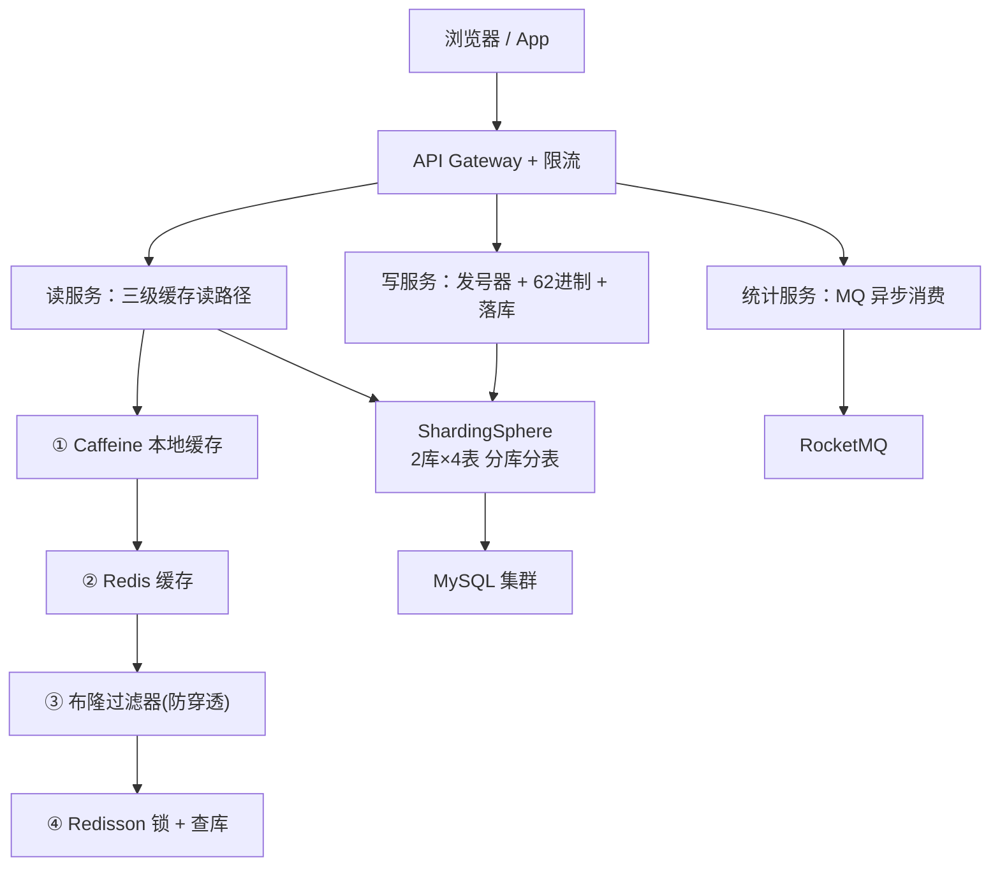

# TurboLink 高并发短链系统

一个面向**高并发读写**场景的短链服务，重点解决「海量读 + 写并发冲突 + 存储扩展」三大问题。业务规则简单（长链→短链→跳转），但把并发、缓存、分布式存储等硬核技术挖到了生产级深度。

## 核心亮点

- **号段模式发号器**：双缓冲预取 + DB 乐观锁，绝大多数取号零 DB 访问、无锁、无冲突
- **三级缓存读路径**：Caffeine 本地缓存 → Redis → 布隆过滤器 → 互斥锁查库，分别解决命中率、穿透、击穿
- **ShardingSphere 分库分表**：按 `short_code` 哈希路由，2 库 × 4 表 = 8 片
- **双写扩容迁移**：2 库 → 4 库不停服，含双写、幂等搬迁、一致性校验、清理残留
- **RocketMQ 异步统计**：跳转事件异步投递，统计旁路不阻塞主链路
- **域名黑名单 + 自定义短码**：恶意链接拦截、短码冲突与格式校验

## 架构图



读路径是性能核心，按「本地缓存 → Redis → 布隆过滤器 → 互斥锁查库」逐级下沉：

| 层 | 解决什么 | 手段 |
|----|---------|------|
| ① Caffeine | 命中率（热点 key 纳秒返回） | 本地内存缓存 |
| ② Redis | 命中率（分布式缓存） | 带 TTL 抖动防雪崩 |
| ③ 布隆过滤器 | **缓存穿透**（无效短码拦在 DB 外） | 判不存在 100% 准确 |
| ④ Redisson 锁 | **缓存击穿**（热点 key 失效瞬间） | 只锁同一个短码 |

## 技术栈

| 层 | 选型 |
|----|------|
| 框架 | Spring Boot 3.2.5 + MyBatis-Plus |
| 存储 | MySQL 8.0（ShardingSphere-JDBC 5.5 分库分表） |
| 缓存 | Redis + Redisson + Caffeine |
| 消息 | RocketMQ 5.3（异步访问统计） |
| 发号器 | 自研号段模式（双缓冲 + 乐观锁） |
| 压测 | 自研零依赖工具（JDK HttpClient） |

## 性能数据（单机实测，详见[压测报告](docs/压测报告.md)）

| 场景 | QPS | P99 |
|------|-----|-----|
| 读·缓存命中（峰值@50并发） | **27,821** | 6.9ms |
| 读·穿透 MySQL | 7,718 | — |
| 读·缓存命中 + MQ 异步 | ~20,000 | — |
| 写·同步落库 | 1,428 | 950ms |

**关键结论**：
- 读 ‖ 写 ≈ **20×**（短链是典型的读多写少）
- 缓存命中 ‖ 穿透 DB ≈ **3.6×**（缓存的核心价值）
- 读路径 50 并发是拐点，超过后延迟飙升

> 注：应用、MySQL、Redis、压测客户端同机运行，数据偏保守；生产多机部署会有更好表现。

## 压测发现并修复的 4 个真实 bug

单元测试全部通过，但真实压测暴露了 4 个生产级缺陷（详见[压测报告](docs/压测报告.md)）：

1. **号段复用竞态** — 预取与切换之间存在窗口，导致整段 ID 重复
2. **过度取号** — 预取任务提交后判重，浪费 19 倍 DB 取号
3. **短码唯一键误冲突** — `utf8mb4_ai_ci` 大小写不敏感，`1a`/`1A` 被判同一值（1..2000 恰好冲突 832 个，与实测完全吻合）
4. **布隆重启未预热** — Redis 清空后存量短码全部 404

## 扩容迁移（2 库 → 4 库）

采用**双写迁移**方案，全程不停服（详见[扩容迁移](docs/扩容迁移.md)）：

```
单写旧库 → 开启双写 → 幂等搬迁存量 → 一致性校验 → 切读 + 关旧写
```

迁移中发现并解决 3 个工程问题：双写主键冲突（新旧路由同库表）、搬迁与双写数据重叠（幂等 INSERT）、旧库残留清理。

## 快速开始

### 前置依赖

- MySQL 8.0（执行 `src/main/resources/db/sharding-schema.sql` 建库表）
- Redis（默认 127.0.0.1:6379）
- RocketMQ（NameServer 9876 + Broker 10911）

### 运行

数据库密码通过环境变量注入（配置文件中不存明文）：

```bash
# Linux / macOS
export DB_PASSWORD=你的数据库密码

# Windows (CMD)
set DB_PASSWORD=你的数据库密码

mvn spring-boot:run
# 或
java -jar target/turbolink-1.0.0.jar
```

若未设置 `DB_PASSWORD`，密码默认为空（连接本机 MySQL 时通常需要设置）。

### 接口

| 接口 | 说明 |
|------|------|
| `POST /api/shorten` | 生成短链，`{"longUrl":"...","customCode":"可选"}` |
| `GET /{shortCode}` | 302 跳转到原链接 |
| `POST /api/migration/dual-write/on` | 迁移：开启双写 |
| `POST /api/migration/read-new/on` | 迁移：切读新库 |
| `GET /api/migration/phase` | 查询迁移状态 |

## 文档

- [压测方案与报告](docs/压测报告.md) — 压测工具、完整数据、4 个 bug 详情
- [扩容迁移](docs/扩容迁移.md) — 双写迁移五阶段、踩坑记录

## 项目结构

```
turbolink/
├── src/main/java/com/turbolink/
│   ├── sequence/      # 号段发号器（双缓冲 + 乐观锁）
│   ├── bloom/         # 布隆过滤器 + 启动预热
│   ├── cache/         # Caffeine 本地缓存
│   ├── service/       # 核心服务（三级缓存读路径 + 黑名单）
│   ├── migration/     # 双写迁移协调器
│   ├── mq/            # RocketMQ 生产者/消费者
│   ├── util/          # Base62、分片路由
│   └── ...
├── src/main/resources/
│   ├── sharding-datasource.yml   # 2库4表分片配置
│   ├── sharding-4db.yml          # 扩容后 4库4表配置
│   └── db/                       # 建库建表 SQL
├── benchmark/         # 自研压测工具 + 迁移脚本
└── docs/              # 压测报告、扩容迁移文档
```
